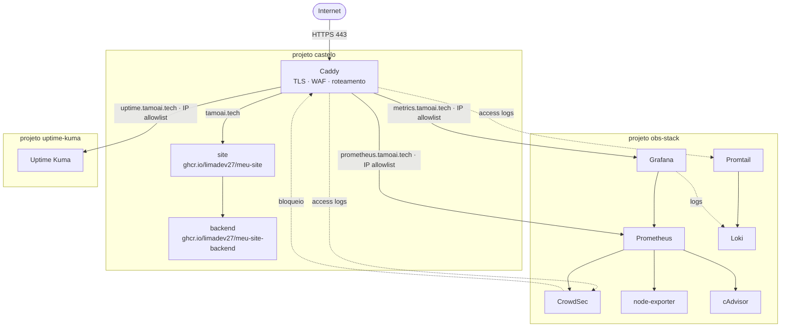
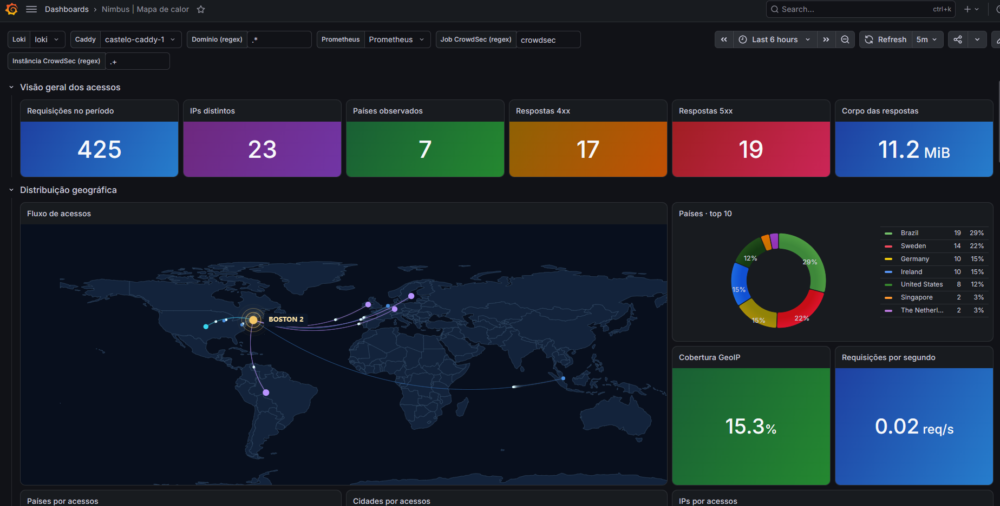
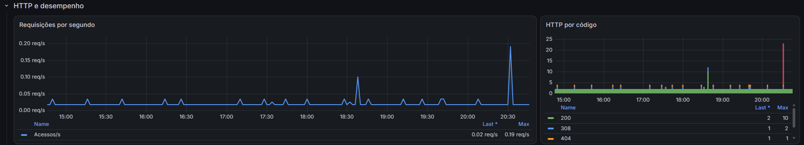
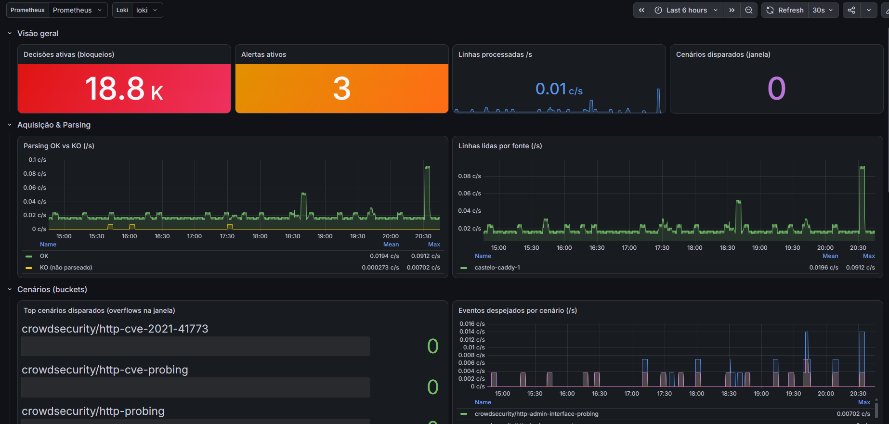
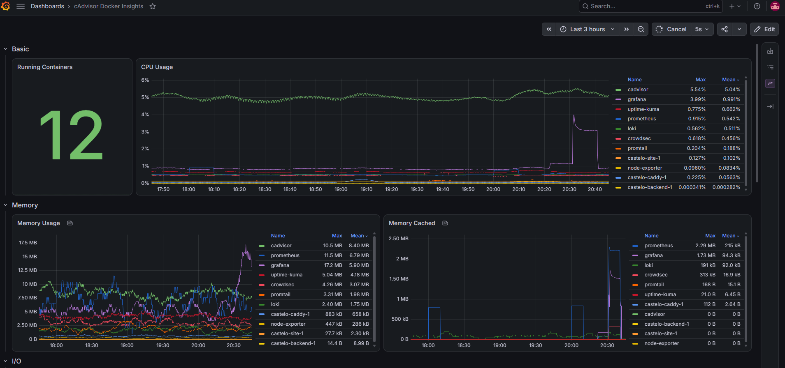
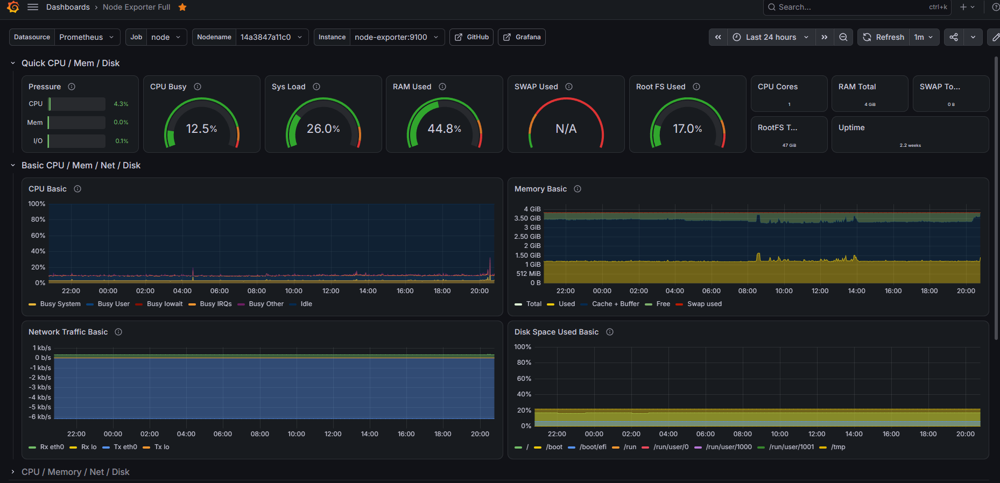
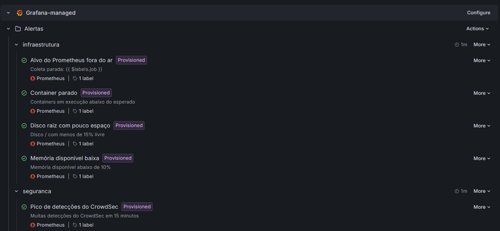
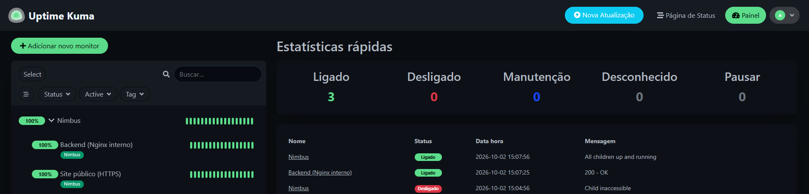

# 🏰 Tamoai-Infra — Infraestrutura `tamoai.tech`

> Infraestrutura de produção num único servidor para a aplicação **tamoai.tech**: TLS automático com
> certificado wildcard, WAF/IPS com bloqueio na borda, métricas, logs com geolocalização, alertas e
> página de status. Tudo como código em Docker Compose — inclusive dashboards, datasources e regras
> de alerta do Grafana — organizado em três projetos que se comunicam por redes dedicadas.


---

## 📋 Informações

| Item | Valor |
|---|---|
| Site público | https://tamoai.tech |
| Página de status | https://uptime.tamoai.tech *(acesso restrito por IP)* |
| Métricas / dashboards | https://metrics.tamoai.tech *(acesso restrito por IP)* |
| Prometheus | https://prometheus.tamoai.tech *(acesso restrito por IP)* |
| Aplicação (site + backend) | [limadev27/DevOps-Computa-o-em-Nuvem](https://github.com/limadev27/DevOps-Computa-o-em-Nuvem) |
| Infraestrutura (este repo) | [guisosi/Tamoai-Infra](https://github.com/guisosi/Tamoai-Infra) |
| Hospedagem | VPS único (Linux + Docker) |

### Autoria

- **Infraestrutura (todo este repositório): [@guisosi](https://github.com/guisosi)** — arquitetura,
  Caddy com TLS/DNS-01, CrowdSec (detecção e bloqueio), observabilidade (Prometheus, Grafana,
  Loki/Promtail com GeoIP), alertas, Uptime Kuma, redes e hardening.
- Aplicação (site e backend, publicados como imagens no GHCR):
  [@limadev27](https://github.com/limadev27/DevOps-Computa-o-em-Nuvem).

Projeto desenvolvido para a disciplina **DevOps e Computação em Nuvem** do curso de **Ciência da
Computação** (3º semestre), apresentado em **2026** e mantido em produção desde então.

---

## 📑 Índice

1. [Sobre o projeto](#1-sobre-o-projeto)
2. [Arquitetura](#2-arquitetura)
3. [Tecnologias](#3-tecnologias)
4. [Estrutura do repositório](#4-estrutura-do-repositório)
5. [Redes: como os três projetos conversam](#5-redes-como-os-três-projetos-conversam)
6. [Borda: Caddy (TLS, DNS-01 e roteamento)](#6-borda-caddy-tls-dns-01-e-roteamento)
7. [Segurança: CrowdSec e hardening](#7-segurança-crowdsec-e-hardening)
8. [Observabilidade: Prometheus, Grafana e Loki](#8-observabilidade-prometheus-grafana-e-loki)
9. [Disponibilidade: Uptime Kuma](#9-disponibilidade-uptime-kuma)
10. [Variáveis de ambiente](#10-variáveis-de-ambiente)
11. [Como subir](#11-como-subir)
12. [Decisões de projeto](#12-decisões-de-projeto)
13. [Limitações e próximos passos](#13-limitações-e-próximos-passos)

---

## 1. Sobre o projeto

Este repositório é a **camada de infraestrutura** do `tamoai.tech`. Ele não contém o código da
aplicação — o site e o backend vêm prontos como imagens no GHCR
(`ghcr.io/limadev27/meu-site` e `ghcr.io/limadev27/meu-site-backend`), construídas no
[repositório da aplicação](https://github.com/limadev27/DevOps-Computa-o-em-Nuvem). Aqui está
tudo o que **recebe o tráfego, protege, observa e monitora** essa aplicação.

São três projetos Docker Compose independentes, que rodam no mesmo host e se integram por redes
Docker compartilhadas:

| Projeto | Papel |
|---|---|
| `castelo/` | Borda (Caddy) + aplicação (site + backend) |
| `obs-stack/` | Observabilidade (métricas e logs) + motor de WAF (CrowdSec) |
| `uptime-kuma/` | Monitoramento de disponibilidade (status page) |

---

## 2. Arquitetura



**Fluxo em uma frase:** todo request entra pelo Caddy na 443; ele valida IP e passa pelo
CrowdSec antes de rotear para o destino (site, Grafana, Prometheus ou Uptime Kuma); em paralelo,
os logs do Caddy alimentam o CrowdSec (que bloqueia ataques) e o Loki (via Promtail, com GeoIP),
enquanto o Prometheus coleta métricas de todos os componentes.

### Telas

**Mapa de acessos** — logs do Caddy no Loki, enriquecidos com GeoIP pelo Promtail:





**CrowdSec** — decisões de bloqueio, parsing dos logs e cenários disparados:



<details>
<summary><b>Containers (cAdvisor) e host (Node Exporter)</b></summary>





</details>

---

## 3. Tecnologias

| Camada | Ferramenta | Função |
|---|---|---|
| Borda / proxy reverso | **Caddy** (imagem custom) | TLS automático, roteamento, compressão, bouncer do CrowdSec |
| Certificados | **Let's Encrypt** | Emissão automática; wildcard via DNS-01 |
| DNS | **Hostinger** (plugin Caddy) | Desafio DNS-01 para o certificado `*.tamoai.tech` |
| WAF / IPS | **CrowdSec** | Lê os logs do Caddy e bloqueia comportamento malicioso na borda |
| Métricas | **Prometheus** | Coleta de métricas (scrape a cada 15s) |
| Métricas de host | **node-exporter** | CPU, memória, disco, rede do host |
| Métricas de container | **cAdvisor** | Uso de recursos por container |
| Dashboards | **Grafana** | Visualização de métricas e logs |
| Logs | **Loki** + **Promtail** | Agregação de logs de todos os containers, com GeoIP nos acessos |
| Disponibilidade | **Uptime Kuma** | Monitoramento e página de status |
| Execução | **Docker Compose** | Orquestração dos três projetos |

---

## 4. Estrutura do repositório

```
.
├── castelo/                      # borda + aplicação
│   ├── compose.yaml              # site, backend, caddy
│   ├── infra/
│   │   ├── Caddyfile             # roteamento, TLS, allowlists
│   │   └── Dockerfile.caddy      # Caddy + plugins (CrowdSec, Hostinger DNS)
│   └── data/                     # runtime do Caddy (certificados etc.) — ignorado no git
│
├── obs-stack/                    # observabilidade + segurança
│   ├── docker-compose.yml        # crowdsec, prometheus, grafana, loki, promtail, node-exporter, cadvisor
│   ├── prometheus.yml            # alvos de scrape
│   ├── grafana/
│   │   ├── dashboards/           # dashboards em JSON (cAdvisor, CrowdSec, Node Exporter, mapa de acessos)
│   │   └── provisioning/
│   │       ├── datasources/      # Prometheus e Loki
│   │       ├── dashboards/       # carrega os JSON de grafana/dashboards
│   │       └── alerting/         # regras de alerta (+ notificação Telegram opcional)
│   ├── loki-config.yaml          # config do Loki
│   ├── promtail-config.yaml      # coleta de logs + GeoIP
│   └── acquis.yaml               # fontes de log do CrowdSec
│
├── uptime-kuma/
│   └── compose.yaml              # Uptime Kuma
│
├── .gitignore                    # ignora .env, chaves, certificados e dados de runtime
└── README.md
```

> Os arquivos `.env`, chaves privadas, certificados e as pastas `data/` **não** estão versionados
> (ver `.gitignore`). Só as configurações entram no repositório. Cada projeto com segredos tem um
> `.env.example` com os nomes das variáveis e os valores vazios.

---

## 5. Redes: como os três projetos conversam

A integração entre projetos separados é feita por **três redes Docker**:

| Rede (no compose → nome no Docker) | Tipo | Quem usa | Para quê |
|---|---|---|---|
| `web` → `castelo_web` | interna | site, backend, caddy, uptime-kuma | Tráfego da aplicação; sem acesso externo |
| `edge` → `castelo_edge` | bridge | caddy, uptime-kuma | Camada de borda |
| `obs` → `obs` | externa | caddy, crowdsec, prometheus, grafana, loki… | Liga o Caddy à stack de observabilidade |

A rede `obs` é declarada como **externa** nos dois lados, com nome fixo. É isso que permite o
Caddy (do projeto `castelo`) falar com o Grafana e o Prometheus (do projeto `obs-stack`) e o
CrowdSec ler os logs do container `castelo-caddy-1`. Por isso ela precisa existir **antes** de
subir as stacks (ver [Como subir](#11-como-subir)).

---

## 6. Borda: Caddy (TLS, DNS-01 e roteamento)

O Caddy é a única porta de entrada — o único container com portas publicadas (80 e 443). Imagem
custom (`Dockerfile.caddy`) com os plugins de CrowdSec e do provedor DNS Hostinger.

**Certificados:**
- Domínio raiz e subdomínios públicos: Let's Encrypt via HTTP.
- Wildcard `*.tamoai.tech`: desafio **DNS-01** pelo Hostinger (TTL 300s), usando `HOSTINGER_API_TOKEN`.

**Roteamento (resumo do `Caddyfile`):**

| Host | Destino | Controle de acesso |
|---|---|---|
| `tamoai.tech` | `site:80` | CrowdSec + compressão (zstd/gzip) |
| `www.tamoai.tech` | redirect 301 → `tamoai.tech` | — |
| `uptime.tamoai.tech` | `uptime-kuma:3001` | Allowlist de IP (senão 403) |
| `metrics.tamoai.tech` | `grafana:3000` | Allowlist de IP (senão 403) |
| `prometheus.tamoai.tech` | `prometheus:9090` | Allowlist de IP (senão 403) |
| outros `*.tamoai.tech` | — | 404 |

Os subdomínios administrativos (métricas, Prometheus, status) ficam atrás de **allowlist de IP**
definida no próprio `Caddyfile` — não são expostos à internet aberta, mesmo tendo TLS válido.

---

## 7. Segurança: CrowdSec e hardening

**CrowdSec** atua em dois tempos:
1. **Detecção** — lê os logs de acesso do Caddy (via `acquis.yaml`, fonte `docker` no container
   `castelo-caddy-1`) e avalia contra as *collections* instaladas: `caddy`, `base-http-scenarios`,
   `http-cve` e `linux`.
2. **Bloqueio** — o *bouncer* embutido no Caddy consulta o CrowdSec a cada request e bloqueia na
   borda os IPs com comportamento malicioso.

**Hardening aplicado nos containers:**
- `no-new-privileges: true` em todos os serviços expostos.
- Rede da aplicação (`web`) **interna** — site e backend não têm rota para a internet.
- Serviços administrativos (Grafana, Prometheus) **sem porta publicada** — acessíveis só via Caddy, e ainda com allowlist de IP.
- Logs com rotação (`json-file`, 10 MB × 3 arquivos) para não encher o disco.
- CrowdSec e Prometheus com porta ligada só em `127.0.0.1` quando expostas no host.

---

## 8. Observabilidade: Prometheus, Grafana e Loki

**Métricas (Prometheus)** — scrape a cada 15s, quatro alvos:

| Job | Alvo | Coleta |
|---|---|---|
| `prometheus` | `localhost:9090` | O próprio Prometheus |
| `node` | `node-exporter:9100` | Métricas do host |
| `cadvisor` | `cadvisor:8080` | Métricas por container |
| `crowdsec` | `crowdsec:6060` | Métricas do WAF |

**Grafana como código** — tudo o que o Grafana usa vem de arquivos versionados em
`obs-stack/grafana/`, carregados no start pelo *provisioning*:

| O quê | Arquivo | Conteúdo |
|---|---|---|
| Datasources | `provisioning/datasources/datasources.yaml` | Prometheus (padrão) e Loki, com UIDs fixos |
| Dashboards | `dashboards/*.json` | cAdvisor (containers), Node Exporter Full (host), CrowdSec (detecções e bloqueios), mapa de calor dos acessos (Loki + GeoIP) |
| Alertas | `provisioning/alerting/regras.yaml` | 5 regras, descritas abaixo |

Os dashboards ficam **somente leitura** na interface: mudanças são feitas no JSON e entram por
deploy, como qualquer outro código. O painel ECharts (volkovlabs) é instalado no start e o acesso é
só por `metrics.tamoai.tech`.

**Alertas (Grafana Alerting)** — avaliados a cada minuto sobre as métricas do Prometheus:

| Regra | Condição | Severidade |
|---|---|---|
| Alvo do Prometheus fora do ar | `up < 1` por 2 min | crítica |
| Container parado | menos containers rodando que o esperado (11) por 3 min | crítica |
| Disco raiz com pouco espaço | menos de 15% livre em `/` por 10 min | aviso |
| Memória disponível baixa | menos de 10% disponível por 10 min | aviso |
| Pico de detecções do CrowdSec | mais de 30 cenários disparados em 15 min | aviso |



A notificação no Telegram está pronta em `provisioning/alerting/telegram.yaml.desativado`: basta
preencher `TELEGRAM_BOT_TOKEN` e `TELEGRAM_CHAT_ID` no `.env` e renomear o arquivo para `.yaml`.
Sem ela, os alertas aparecem na tela *Alerting* do Grafana.

**Logs (Loki + Promtail)** — o Promtail descobre todos os containers pelo socket do Docker e
envia o `stdout`/`stderr` deles para o Loki (`http://loki:3100`). Os logs de acesso do Caddy
recebem um tratamento extra: um estágio **GeoIP** (base GeoLite2-City, compartilhada com o
CrowdSec) adiciona país como *label* e latitude/longitude/cidade como metadados estruturados —
permitindo mapa de origem dos acessos no Grafana.

---

## 9. Disponibilidade: Uptime Kuma

O **Uptime Kuma** (`louislam/uptime-kuma:1`) monitora a disponibilidade dos serviços e publica a
página de status em `uptime.tamoai.tech` (atrás da allowlist de IP). Dados persistidos no volume
`kuma-data`. Participa das redes `web` e `edge` para alcançar os alvos internos e ser servido
pelo Caddy.

Os monitores ficam agrupados: o grupo **Nimbus** só aparece como ligado quando o site público
(HTTPS, de fora para dentro) e o backend (pela rede interna) respondem.



---

## 10. Variáveis de ambiente

Os segredos ficam em arquivos `.env` **fora do versionamento**. Cada projeto que precisa declara
suas variáveis; o Compose aborta se alguma faltar (`${VAR:?defina no .env}`).

**`castelo/.env`**

| Variável | Para quê |
|---|---|
| `JWT_SECRET` | Segredo de assinatura do backend |
| `CADDY_IMAGE` | Tag da imagem custom do Caddy |
| `HOSTINGER_API_TOKEN` | Token da API Hostinger (desafio DNS-01) |
| `CROWDSEC_API_KEY` | Chave do bouncer CrowdSec no Caddy |

**`obs-stack/.env`**

| Variável | Para quê |
|---|---|
| `GRAFANA_PASSWORD` | Senha do admin do Grafana |
| `TELEGRAM_BOT_TOKEN` | *(opcional)* Bot do Telegram para os alertas |
| `TELEGRAM_CHAT_ID` | *(opcional)* Chat que recebe os alertas |

Os modelos estão em `castelo/.env.example` e `obs-stack/.env.example`.

---

## 11. Como subir

**Pré-requisitos:** Docker e Docker Compose no host; registros DNS de `tamoai.tech` apontando
para o IP do VPS; arquivos `.env` preenchidos em `castelo/` e `obs-stack/`.

```bash
# 0. preencher os segredos a partir dos modelos
cp castelo/.env.example castelo/.env && cp obs-stack/.env.example obs-stack/.env
# (edite os dois .env)

# 1. criar a rede compartilhada de observabilidade (uma vez)
docker network create obs

# 2. subir a observabilidade primeiro (CrowdSec precisa estar de pé antes do Caddy)
cd obs-stack && docker compose up -d && cd ..

# 3. subir a aplicação + borda
cd castelo && docker compose up -d && cd ..

# 4. subir o status
cd uptime-kuma && docker compose up -d && cd ..
```

Verificação:

```bash
docker compose -f castelo/compose.yaml ps
curl -I https://tamoai.tech
```

---

## 12. Decisões de projeto

| Decisão | Por quê |
|---|---|
| **Caddy** como borda | TLS automático sem cron nem certbot, configuração curta, e o bouncer do CrowdSec e o provedor DNS entram como plugins compilados na própria imagem (`Dockerfile.caddy`). |
| **Wildcard via DNS-01** | Um único certificado cobre os subdomínios administrativos, que não precisam ser alcançáveis pela internet para validar o certificado. |
| **CrowdSec** com bouncer na borda | Detecção por cenários nos logs do Caddy e bloqueio no próprio proxy, antes de o request chegar à aplicação; também recebe a blocklist da comunidade. |
| **Três projetos Compose** ligados por rede externa | Borda, observabilidade e status sobem e caem de forma independente: atualizar o Grafana não derruba o site. |
| **Rede da aplicação interna** | Site e backend não têm rota de saída para a internet; só o Caddy fala com eles. |
| **Grafana provisionado por arquivo** | O ambiente de observabilidade é reproduzível a partir do repositório e toda mudança passa por versionamento. |
| **VPS único** | Escopo e custo de um projeto acadêmico; a alta disponibilidade fica declarada como limitação. |

---

## 13. Limitações e próximos passos

Pontos conhecidos, declarados abertamente:

- **VPS único, sem alta disponibilidade.** Se o host cai, tudo cai — não há failover nem réplica.
- **Backup via Hostinger.** A VPS tem snapshot (ponto-no-tempo) e backup automático semanal,
  cobrindo recuperação completa do host em caso de perda. O que **ainda não existe** é backup
  granular por volume Docker (`grafana_data`, `prometheus_data`, `loki_data`, `kuma-data`, dados
  do CrowdSec) — restaurar um serviço isolado hoje exige recuperar o servidor inteiro a partir do
  snapshot.
- **Limite de containers fixo no alerta.** A regra "Container parado" compara com o total esperado
  (11); ao adicionar ou remover serviços, o número precisa ser atualizado em `regras.yaml`.
- **Segredos em `.env` texto puro.** Fora do git (correto), mas sem cofre (Vault/SOPS) — melhoria
  futura para rotação e auditoria.
- **CI/CD mora no repo da aplicação.** Este repositório é de *deploy*; o build e o push das
  imagens acontecem no [repo do app](https://github.com/limadev27/DevOps-Computa-o-em-Nuvem).

**Já feito depois da apresentação:** datasources, dashboards e alertas do Grafana passaram a ser
provisionados como código, e os `.env.example` documentam os segredos de cada projeto.

**Próximos passos:** backup granular por volume (complementando o snapshot do host), ativar a
notificação dos alertas no Telegram e um workflow de CI que valide os arquivos Compose e YAML a cada
push.

---

<div align="center">

Infraestrutura de **tamoai.tech** · mantida por [@guisosi](https://github.com/guisosi)

</div>
